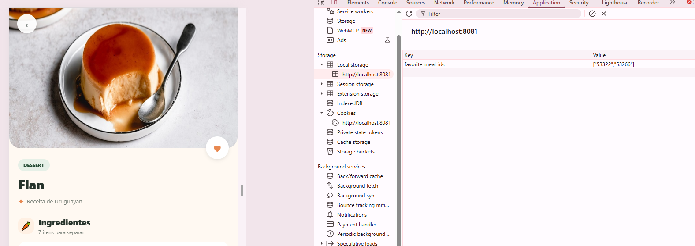

# Receitas — TheMealDB + React Native

Aplicativo mobile do projeto final da disciplina Arquitetura de Aplicações Móveis e Multiplataforma. O app usa a API pública TheMealDB e React Native com Expo.

> **Estado atual:** as cinco funcionalidades principais estão implementadas, com testes automatizados, capturas de tela e build Android validados.

## Integrantes

- João Vítor Vieira Martins
- Júlio César Fernandes
- Jhonathan Carvo
- William Tavares de Moura

## Funcionalidades exigidas

- [x] Lista de receitas carregada da API TheMealDB.
- [x] Navegação da lista para os detalhes da receita.
- [x] Busca textual na lista.
- [x] Filtro de receitas por categoria usando a API.
- [x] Favoritos persistidos localmente após fechar e reabrir o app.
- [x] Estados de carregamento, lista vazia e erro/sem internet.

## Requisitos

- Node.js 22 ou superior.
- npm.
- Android Studio e um emulador Android, ou um dispositivo Android para executar o app.
- Expo Go pode não suportar todas as dependências nativas; para AsyncStorage e navegação nativa, prefira o development build.

## Como instalar e executar no Android

### Requisitos

- Node.js 22 ou superior e npm.
- Android Studio com Android SDK, Android Emulator e uma imagem de sistema instalados.
- Java JDK 21.
- Conexão com a internet para instalar dependências e carregar receitas da TheMealDB.

### Primeira execução

1. Abra o Android Studio. Na tela inicial, acesse **More Actions > Virtual Device Manager** (em algumas versões, **Device Manager**).
2. Se ainda não houver um dispositivo virtual, crie um em **Create Virtual Device**, escolha um modelo de celular e instale uma imagem de sistema Android. Depois, use o botão **▶** para iniciar o emulador.
3. Aguarde o emulador chegar à tela inicial do Android.
4. Abra a pasta do projeto no VS Code e abra um terminal na raiz do repositório.
5. Instale as dependências e compile/abra o app:

```powershell
npm ci
npm run android
```

O primeiro build pode levar alguns minutos. O Expo compila o app Android, instala a versão de desenvolvimento no emulador e inicia o servidor Metro.

### Execuções seguintes

Com o emulador iniciado e o app já instalado, rode:

```powershell
npm start
```

No menu do Expo, pressione `a` para abrir o app no emulador Android. Também é possível usar `npm run android`, que compila ou atualiza o app instalado.

### Usar um celular Android

Ative as **Opções do desenvolvedor** e a **Depuração USB** no celular, conecte-o ao computador e aceite a autorização exibida no aparelho. Com o dispositivo conectado, execute `npm run android`.

### Se o dispositivo não for detectado

Confira no terminal se o ADB reconhece o emulador ou celular:

```powershell
adb devices
```

O dispositivo deve aparecer com o estado `device`. Se não aparecer, inicie o emulador pelo Device Manager ou confira o cabo e a autorização de depuração USB no celular.

### Executar no navegador

Para uma demonstração alternativa sem emulador, rode:

```powershell
npm run web
```

O navegador não substitui a validação mobile Android; use o emulador ou um dispositivo para apresentar o app como aplicativo mobile.

## Estrutura

```text
App.tsx                  Navegação principal
src/api/                 Integração HTTP com TheMealDB
src/screens/             Lista, detalhes, favoritos e navegação inferior
src/storage/             Persistência local de favoritos
src/types/               Modelos de dados
flows/                   Flows de exemplo herdados do skeleton
```

## API

- Lista: `https://www.themealdb.com/api/json/v1/1/search.php?s=`
- Detalhe: `https://www.themealdb.com/api/json/v1/1/lookup.php?i={id}`
- Categoria: `https://www.themealdb.com/api/json/v1/1/filter.php?c={categoria}`

A API não exige uma chave privada para os endpoints utilizados. A busca textual é aplicada localmente sobre a lista atual; a seleção de categoria carrega as receitas dessa categoria pela própria API.

## Testes e validação

Execute os testes automatizados com:

```bash
npm test
```

Eles cobrem busca, integração e mapeamento da API, tratamento de erro e persistência/toggle dos favoritos. Os flows em `flows/` são exemplos opcionais do skeleton e não substituem esses testes.

O APK debug foi compilado com sucesso para `arm64-v8a` usando Expo SDK 58 e JDK 21. Em Windows, use um caminho curto para o repositório se o Ninja reportar limite de comprimento de caminho.

## Auditoria de dependências

`npm audit` não reporta vulnerabilidades. As dependências transitivas `glob` e `minimatch` são mantidas em versões corrigidas por overrides compatíveis com o Expo SDK 58, sem downgrade do SDK.

## Screenshots

Capturas do app em viewport mobile (Expo Web), com dados carregados da TheMealDB:

### Lista de receitas


### Detalhe da receita


### Favoritos


### Persistência dos favoritos

Ao favoritar uma receita, os IDs são gravados pelo AsyncStorage na chave `favorite_meal_ids`. Na versão web ele usa o `localStorage` do navegador, como mostra o DevTools; no Android, usa o armazenamento nativo do aparelho.



## Decisões de arquitetura

Consulte [ADR.md](./ADR.md).

## Apresentação técnica

Os slides estão disponíveis em [HTML](./apresentacao.html) e [PDF](./apresentacao.pdf). O roteiro dividido entre os quatro integrantes está em [ROTEIRO-APRESENTACAO.md](./ROTEIRO-APRESENTACAO.md).
