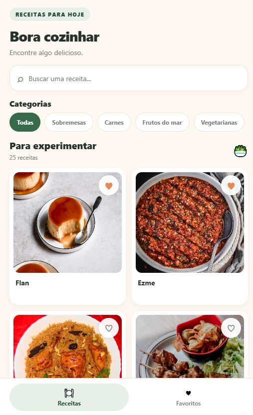
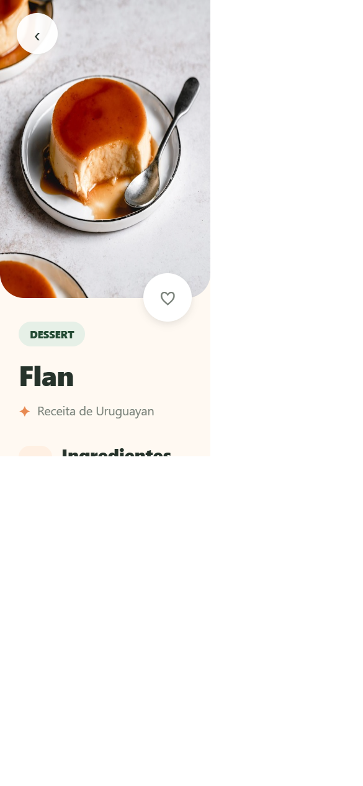
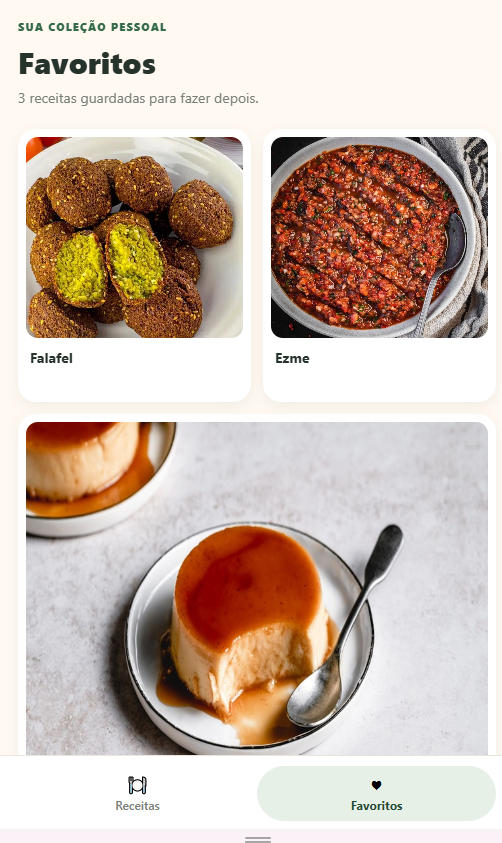

# Receitas — TheMealDB + React Native

Aplicativo mobile do projeto final da disciplina Arquitetura de Aplicações Móveis e Multiplataforma. O app usa a API pública TheMealDB e React Native com Expo.

> **Estado atual:** as cinco funcionalidades principais estão implementadas, com testes automatizados, capturas de tela e build Android validados.

## Integrantes

- João Vítor Vieira Martins
- Júlio César Fernandes
- Jhonathan Carvo
- William Tavares de Moura

## Funcionalidades exigidas

- [x] Lista de receitas carregada da API TheMealDB.
- [x] Navegação da lista para os detalhes da receita.
- [x] Busca textual na lista.
- [x] Filtro de receitas por categoria usando a API.
- [x] Favoritos persistidos localmente após fechar e reabrir o app.
- [x] Estados de carregamento, lista vazia e erro/sem internet.

## Requisitos

- Node.js 22 ou superior.
- npm.
- Android Studio e um emulador Android, ou um dispositivo Android para executar o app.
- Expo Go pode não suportar todas as dependências nativas; para AsyncStorage e navegação nativa, prefira o development build.

## Como instalar e executar

Na raiz deste repositório:

```bash
npm install
npm start
```

Para compilar e executar no Android:

```bash
npm run android
```

O comando requer Android Studio, SDK Android e um emulador ou dispositivo conectado.

## Estrutura

```text
App.tsx                  Navegação principal
src/api/                 Integração HTTP com TheMealDB
src/screens/             Lista, detalhes, favoritos e navegação inferior
src/storage/             Persistência local de favoritos
src/types/               Modelos de dados
flows/                   Flows de exemplo herdados do skeleton
```

## API

- Lista: `https://www.themealdb.com/api/json/v1/1/search.php?s=`
- Detalhe: `https://www.themealdb.com/api/json/v1/1/lookup.php?i={id}`
- Categoria: `https://www.themealdb.com/api/json/v1/1/filter.php?c={categoria}`

A API não exige uma chave privada para os endpoints utilizados. A busca textual é aplicada localmente sobre a lista atual; a seleção de categoria carrega as receitas dessa categoria pela própria API.

## Testes e validação

Execute os testes automatizados com:

```bash
npm test
```

Eles cobrem busca, integração e mapeamento da API, tratamento de erro e persistência/toggle dos favoritos. Os flows em `flows/` são exemplos opcionais do skeleton e não substituem esses testes.

O APK debug foi compilado com sucesso para `arm64-v8a` usando Expo SDK 58 e JDK 21. Em Windows, use um caminho curto para o repositório se o Ninja reportar limite de comprimento de caminho.

## Auditoria de dependências

`npm audit` não reporta vulnerabilidades. As dependências transitivas `glob` e `minimatch` são mantidas em versões corrigidas por overrides compatíveis com o Expo SDK 58, sem downgrade do SDK.

## Screenshots

Capturas do app em viewport mobile (Expo Web), com dados carregados da TheMealDB:

### Lista de receitas



### Detalhe da receita



### Favoritos



## Decisões de arquitetura

Consulte [ADR.md](./ADR.md).
